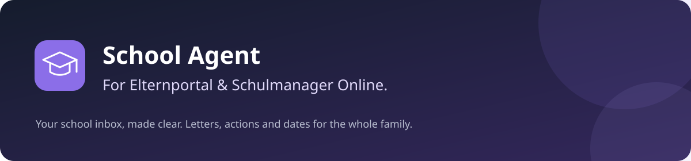
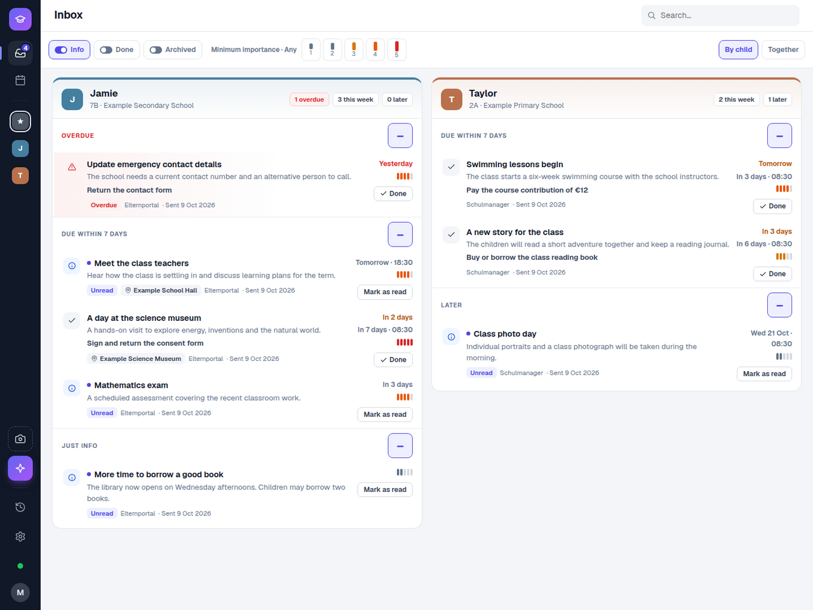
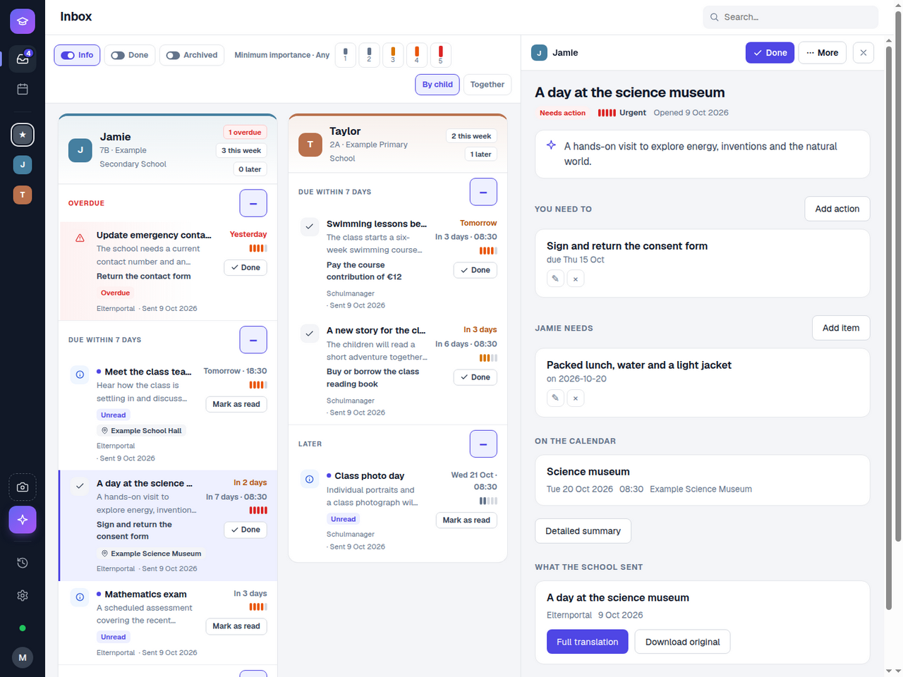
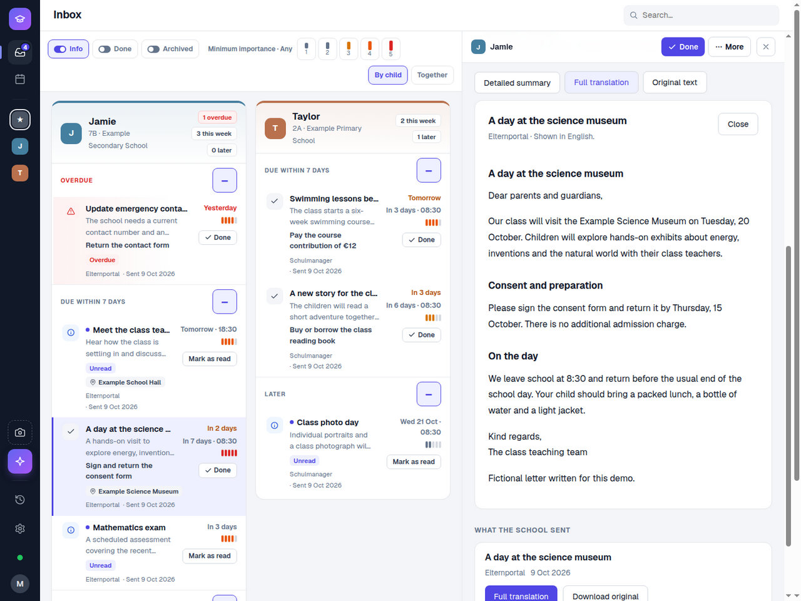
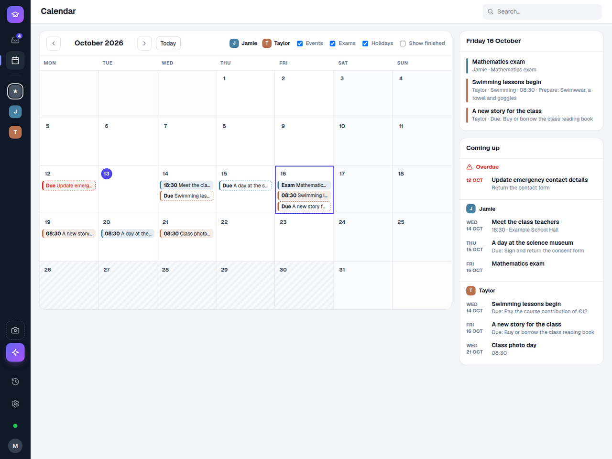
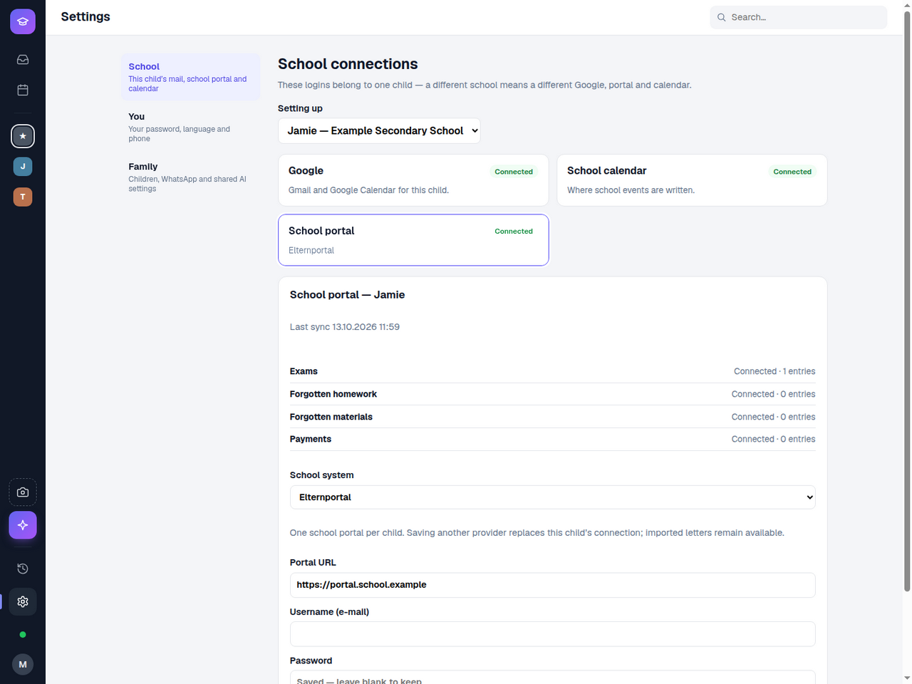
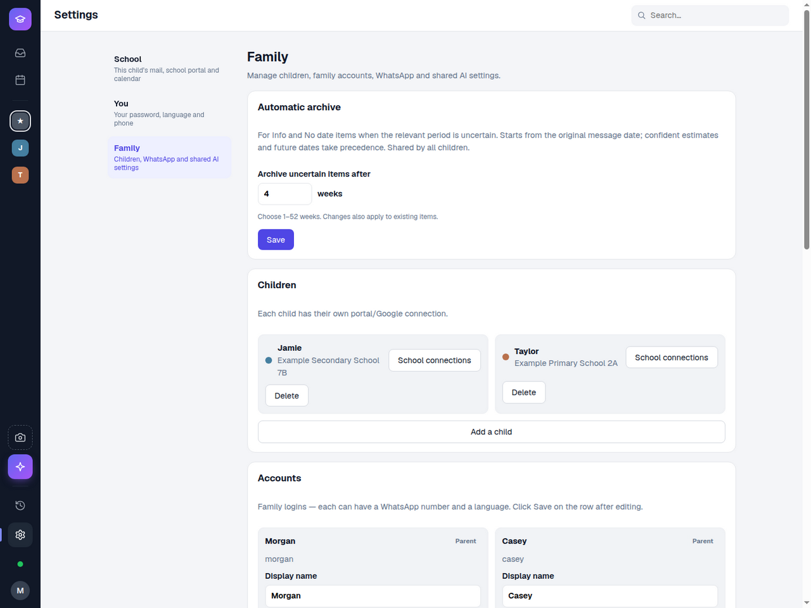
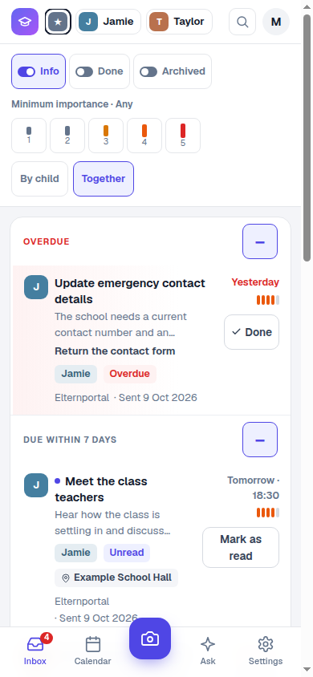
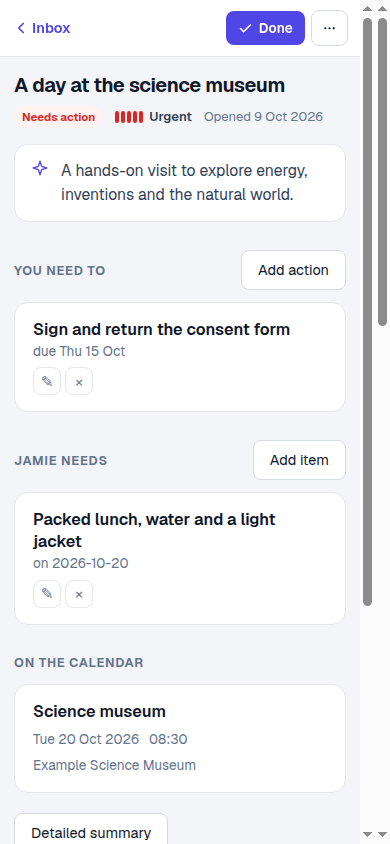

<p align="center">
  
</p>

**School Agent is a self-hosted family companion for Elternportal (Eltern Portal)
and Schulmanager Online.** Connect your child's existing school account to bring
school letters, attachments and supported school records into one clear inbox.

Choose **Elternportal or Schulmanager Online for each child**; siblings can use
different systems. School Agent translates and summarizes school communications,
identifies what parents need to do and what children need to bring, and organizes
dates in a calendar with child-specific WhatsApp reminders. Gmail can supplement
the portal with direct or forwarded school emails.

Self-hosted · Multiple children · English / Spanish · iOS / Android web app

[Explore the screenshots](#a-look-inside) · [Try the UI](#try-the-ui-without-accounts) · [Install](#run-your-own-school-agent) · [Technical docs](#development)



*All screenshots show fictional children, schools and letters in a local demo.
They contain no production records or credentials.*

## Less reading. A clearer plan.

- **Connect your school portal.** Built-in connectors for Elternportal and
  Schulmanager Online import school communications using your existing accounts.
- **One inbox for the family.** Switch between children or see them together. Filter
  by importance, information, completed items and archive; collapse date sections.
- **Know what to do.** Parent actions and child preparation appear separately,
  with school-provided dates, source details and relevant document links.
- **Understand the original.** Read a short description, an extended summary or a
  full translation; keep the original document within reach. Results persist.
- **Keep the calendar useful.** See appointments, deadlines and class exams,
  with holiday shading and an independent Exams filter.
- **Get timely WhatsApp messages.** Child-specific announcements, tomorrow's
  agenda and weekly plans use the configured, approved template catalog.
- **Keep the inbox manageable.** Completed and expired matters stay available
  behind toggles. Retention for information and undated items is configurable.

## A look inside

### From a letter to a practical checklist

A case keeps its parent actions, child preparation, dates and source documents
in one place. Mark actionable matters Done as a family; read marks for information
belong to each parent.



### A document reader you can actually read

Choose a detailed summary, full translation or original text. Download the source
when you need it. Saved translations are reused when you return.



### The school week, together

The calendar brings both children's events together, keeps high-importance items
visible and shades school breaks. Select a day for its agenda or filter class exams.



### Separate schools, shared family settings

Each child has their own portal, mailbox and calendar. WhatsApp and AI configuration
are shared by the family; parents keep their own notification preferences.

<details>
<summary><strong>School connections and native section status</strong></summary>



</details>

<details>
<summary><strong>Family, children and inbox retention</strong></summary>



</details>

### At home on your phone

Install the app on iOS or Android as a PWA. The mobile layout keeps the inbox and
case details usable, and remembers your selected child. Notifications use WhatsApp.

<table>
  <tr>
    <td align="center"></td>
    <td align="center"></td>
  </tr>
  <tr><td align="center">Family inbox</td><td align="center">Letter details</td></tr>
</table>

## School portal connections

**Elternportal and Schulmanager Online are the core school integrations.**
Configure the provider your child's school uses in **Settings → School → School
portal**. One child uses one provider; a family can connect children from both systems.
School Agent works alongside your existing school account.

Gmail, Google Calendar, WhatsApp and manual uploads complement these connections:

| Connection | What it brings |
|---|---|
| **Elternportal** | Letters and attachments; class exams, forgotten-item reports and payments where available |
| **Schulmanager Online** | Letters and supported student-scoped exams, classbook reports and unpaid invoices |
| **Gmail** | Direct or forwarded school emails, attachments and deduplicated threads |
| **Google Calendar** | A child-specific projection of school events |
| **WhatsApp** | Announcements, tomorrow reminders and weekly plans, clearly scoped to a child |
| **Uploads** | School documents and photos supplied by a parent |

Choose **one school portal per child**; siblings can use different providers.
Optional modules depend on the school's permissions and layout. Initial imports
are quiet, and repeated syncs preserve completion/read state.

Email threads retain their Email origin and can be summarized or translated.
School Agent can prepare a reply in the original language for you to copy; it does
not send emails or submit forms to school systems.

## Try the UI without accounts

You only need Node >=22.22.3. Build the frontend, then start the local demo:

```bash
cd frontend
npm ci
npm run build
cd ..
node scripts/demo-server.mjs
```

Open **http://127.0.0.1:4317**. The demo serves fictional data, makes no backend or
external-service requests and rejects write operations. Its date is fixed to
13 October 2026 so the examples stay reproducible. It is a UI preview, not a
production server; settings and Done buttons do not save changes.

## Run your own School Agent

With Docker and Compose v2 installed:

```bash
cp deploy/.env.example deploy/.env
chmod 600 deploy/.env
# Fill the required settings in deploy/.env before continuing.
cd deploy
docker compose up -d --build
```

Set the database password, application origin, persistent vault key and initial
administrator credentials. There are **no default passwords or family accounts**.
Open **http://127.0.0.1:4200**, then add your children and connections in Settings.
AI extraction requires a configured provider; Google and WhatsApp remain optional.

See the [setup guide](docs/SETUP.md) for configuration, integrations and development.
**Existing installations:** before upgrading across the publication cleanup, review
[the V2/V7/V8/V9 checksum procedure](docs/SETUP.md#existing-installations-after-the-publication-cleanup).
Back up first; do not disable Flyway validation.

## Privacy by default, configuration by you

Integration credentials are stored in an encrypted vault. Family records and
operational data stay in your private installation. AI processing shares relevant
content with the provider you configure; Google and WhatsApp use their own services.

Repository examples are fictional. Commit hooks and CI check for secrets and private
content, including docs and fixtures. Read [AGENTS.md](AGENTS.md) before contributing,
install Gitleaks, and enable the hook:

```bash
git config core.hooksPath .githooks
python3 scripts/check-public-content.py
```

## Development

| Layer | Technology |
|---|---|
| Backend | Kotlin 2.3 · Spring Boot 4 · Java 21 |
| Frontend | Angular 22 · TypeScript · Node >=22.22.3 |
| Persistence | PostgreSQL 17 · Flyway |
| Read-only browser worker | Node / TypeScript · Playwright |
| AI | Configurable role-based models; Anthropic-compatible and OpenAI-compatible transports |
| Deployment | Docker Compose |

```bash
./backend/mvnw -f backend/pom.xml test
cd frontend
npm test -- --watch=false
npm run build
```

Backend integration tests require Docker. Screenshots can be reproduced with the
[fictional demo guide](docs/screenshots/README.md).

[Product specification](docs/SPEC.md) · [Architecture](docs/ARCHITECTURE.md) ·
[Frontend conventions](docs/FRONTEND.md) · [Current status and validation limits](PROGRESS.md)
