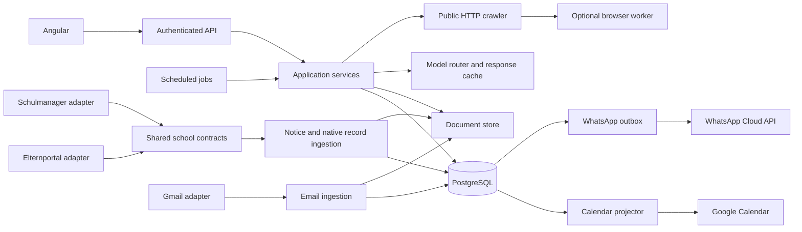

# Architecture

This document describes the implemented system. [SPEC.md](SPEC.md) records product
intent; it is not a claim that every proposed feature exists. The current delivery
ledger is [PROGRESS.md](../PROGRESS.md), UI conventions are in
[FRONTEND.md](FRONTEND.md), and provider capabilities are tracked in
[PORTAL-COVERAGE-PLAN.md](PORTAL-COVERAGE-PLAN.md).

## System shape

School Agent is a modular monolith: an Angular application, a Kotlin/Spring Boot API,
PostgreSQL and a content-addressed document directory. An optional isolated Node
Playwright worker renders permitted external pages. Keep this shape: family-scale
traffic does not justify independent services or an event broker.

PostgreSQL owns accepted cases, duties, dates, completion, source history and pending
work. Calendar is a projection; WhatsApp is a delivery channel. Neither can replace
internal state. Raw documents are addressed by content hash; a recovery point must
include both database and document storage, plus private configuration and images.

## Ownership and dependencies

Paths below are relative to `backend/src/main/kotlin/de/schoolagent`.

| Package | Responsibility | Boundary |
|---|---|---|
| `domain` | Persisted entities, repositories, state machine, case/family mutations | No HTTP or model calls |
| `connectors/school` | Provider-neutral sessions, identity, notices, documents and typed records | Provider payloads stop here |
| `connectors/elternportal`, `connectors/schulmanager` | Authentication and provider parsing | Return shared contracts; no family completion policy |
| `ingestion` | Acquire, deduplicate, preserve provenance, reconcile revisions | Share notice/native-record logic across providers |
| `email` | MIME/forward identity, domain settings and account-notice policy | Mail identity is distinct from school portal identity |
| `documents` | Bounded PDF/DOCX/image/text reading and original storage | Detect format from content; originals remain immutable |
| `crawler` | Bounded public HTTP fetches and browser fallback | Reject private destinations and unsafe redirects |
| `ai` | Configured model transport, validation, caching and usage | Model output is a proposal, never direct database authority |
| `reasoning` | Interpret evidence, resolve/merge cases and validate corrections | Apply accepted changes through audited domain operations |
| `actions`, `requirements`, `events` | Duty changes and calendar projection | Local completion is distinct from school receipt/response |
| `inbox` | Saved presentation copy, relevance and archive visibility | Ordinary reads do not call AI |
| `briefing` | Shared case selection and daily/weekly plan composition | Access and eligibility precede rendering |
| `whatsapp` | Templates, delivery queue, receipt processing and conversational commands | Recheck access/preferences before delivery |
| `security` | Accounts, sessions, authorization and vaulted secrets | Server authorization is authoritative |
| `api` | Request/response mapping and access checks | Controllers should delegate business decisions |
| `scheduling` | Polling, sweeps and bounded retry entry points | Persist progress; do not encode provider parsing |
| `diagnostics`, `health` | Safe decision traces and connector freshness | Distinguish empty results from failed checks |
| `common` | Small deterministic primitives such as hashes and dates | No feature-specific dependencies |

These are package boundaries, not separate build modules. Some older classes combine
several responsibilities; see [ARCHITECTURE-REVIEW.md](ARCHITECTURE-REVIEW.md) for the
remaining pressure points. Avoid a generic framework that hides the different
consistency rules of mail, mutable portal notices and native school records.

## Acquisition and interpretation

### School portals

`SchoolConnector.connect` creates an isolated `SchoolSession`. Every operation binds
a fresh session to a verified child before reading. `SchoolAccountLock` serializes
account context, including siblings and manual tests, using PostgreSQL advisory locks.

`SchoolIngestionService` orchestrates feeds. `SchoolNoticeIngestionService` handles
letters, noticeboard posts and shared connected-account messages. It acquires a
complete candidate document manifest before a short child/case transaction.
`SchoolItem` identities and immutable revisions preserve existing source IDs and
family completion/read state when only document metadata changes. Superseded evidence
is excluded from current reasoning but remains available as authorized history.

`SchoolRecordIngestionService` handles typed exams, homework, payments, reports and
timetable changes. Native dates remain authoritative. Only a proven complete exam
snapshot can withdraw missing future exams. Missing payments never prove settlement.
AVAILABLE-empty, UNAVAILABLE and FAILED are different feed outcomes. Optional feed
failure does not invalidate successful letter synchronization.

Connection settings explicitly control connected-account message sharing and automatic
receipt side effects of document retrieval. Connectors do not submit consent, survey
answers, payments or school messages. Provider-specific capabilities and limitations
belong in the coverage plan rather than conditional branches in the UI or reasoning.

### Email and uploads

Gmail ingestion scopes identities to child and mailbox. `EmailContent` unwraps MIME
and explicit forwards; original message IDs, references and conservative fingerprints
support deduplication and threading. Subject similarity alone does not establish identity.
`email_delivery` maps repeated deliveries to existing sources. Photo/manual acquisition
uses the common document and interpretation pipeline.

Configured school domains match actual original sender/recipient mailboxes, including
subdomains. An empty list accepts the selected mailbox query, except direct Google
Account administration notices. This is not a general semantic school-mail classifier.
Explicit forwards and Classroom/Drive traffic retain their existing rules. The same
provenance policy excludes account-only cases from new notices and newly built plans.

### Evidence and changes

Investigation reads current sources, extracts evidence, follows bounded permitted
links and records its progress. `CaseReasoningService` interprets accumulated evidence
and applies derived actions, requirements and events. Pending case batches run with
per-case transactions and rechecks. Native records can be interpreted deterministically;
model outages retain their original facts and mark wording enrichment as pending.

`SchoolCorrectionService` prepares a proposal outside database locks, then verifies
source fingerprints, target IDs and quotes under the case lock. Stable duty/event IDs
preserve completion and Google identity. Ambiguous corrections remain pending for
review and block stale Done actions.

The stages are direct service calls with persisted progress and periodic recovery
sweeps, not a fully decoupled message pipeline. Original reasoning and some projection
paths still perform remote work within transactions; do not describe all locks as short.
Model output and fetched documents are untrusted. IDs, quotes, dates, amounts and
operations require validation before an accepted mutation.

## Cases, completion and visibility

`CaseStateMachine` defines valid transitions; `CaseService` records status history and
audit. A case groups related communication and owns duties and events. Parent actions,
child requirements and school responses are different concepts. Family Done does not
submit a response to a school. Per-user read/acknowledgment is independent of shared
case completion. New meaningful facts can reopen a case through audited transitions.

Relevance is a saved read projection, evaluated against current sources and a configured
fallback window. Archived means no longer presented as current; it does not complete
or delete duties. Inbox copy and translations are persisted separately from accepted
facts. Date calculations use the Europe/Berlin school calendar; supplied lesson periods
are not invented wall-clock times.

## Plans, notifications and calendar

`BriefingCaseSelector` is the common audience/eligibility boundary for conversational
and scheduled plans. It scopes cases to accessible children and family-shared unassigned cases before loading provenance,
then excludes closed, muted, archived, pending-correction and account-only cases.
Daily priority, homework exceptions, weekly inclusion and date windows are applied
by the composer. Scheduled per-child plans require an assigned case; conversational
plans can include explicitly child-assigned events from shared cases. All four plan
entry paths use the same selection.

`InstantNoticePolicy` handles immediate and retried case alerts; `TimetableNoticePolicy`
ignores teacher/room-only changes while preserving meaningful schedule changes.
`NotificationService` composes notices and `WhatsappOutbox` persists delivery intent.
The outbox checks current access, preferences, case revision and expiry before sending.
It saves an uncertain state before network transmission: a timeout is not permission
to blindly send twice. Provider receipts reconcile accepted/delivered/read states.
Already-composed aggregate plans are snapshots; their rows are not rebuilt on retry.

`CalendarProjectionService` updates stable app-owned Google IDs and persists failures.
`CalendarSyncJob` backfills/retries bounded batches after consent without requiring a
new portal import. Dedicated calendars avoid writing into a fallback primary calendar.
Timetable notices and historical school reports are not calendar appointments.
Changing connected accounts does not authorize deletion using another account's credentials.

## Authentication and frontend

Browser login uses a server session and optional database-backed 14-day remember-me
cookie. The frontend restores identity through `/api/auth/me`; it does not store the
password or a Basic authorization header. Basic authentication remains for API clients.
Cookie-authenticated mutations use Angular's XSRF cookie/header. Provider callbacks
and webhooks have separate state/signature validation. `CurrentAccountFilter` revokes
session privileges after account deletion, password changes or role changes.

A failed login must invalidate any partially created session. Invalid credentials
produce 401; unavailable authentication infrastructure produces a safe 503 response.
Controllers enforce child access through `KidAccessService`; ADMIN can access all
children and PARENT only assigned children. Frontend route guards are convenience,
not a security boundary.

Angular uses standalone components, signals and HttpClient services. Page-specific
presentation models own filtering/grouping; stores own HTTP data and refresh state.
Versioned request handling protects child switches from stale responses. Shared
English/Spanish dictionaries own user-facing copy. Public information pages are static,
unauthenticated and make no private API calls. The service worker caches the generic
offline page only. See FRONTEND.md for routes, layouts and interaction conventions.

## Reliability and operation

Deploy one API process unless concurrency has been reviewed: provider account locks
and selected row locks are distributed, but model single-flight and several job guards
are process-local. Scheduler overlap and horizontal scaling are not interchangeable.

Durable pending flags, delivery rows, unique dedup keys and sweeps recover partial work.
They do not create a distributed transaction with Google or Meta. Connector health
tracks success/failure and freshness; safe diagnostics explain skips and retries.
Docker logs are bounded and compressed; the diagnostic journal has separate retention.

Use the tested compose release tooling: backup database, documents, private configuration
and rollback image references, build, validate migrations, start API, check health, then
serve the UI. Preserve vault keys. Never disable Flyway validation to force an upgrade.
Private deployment identities, configuration and operational records stay outside Git.
